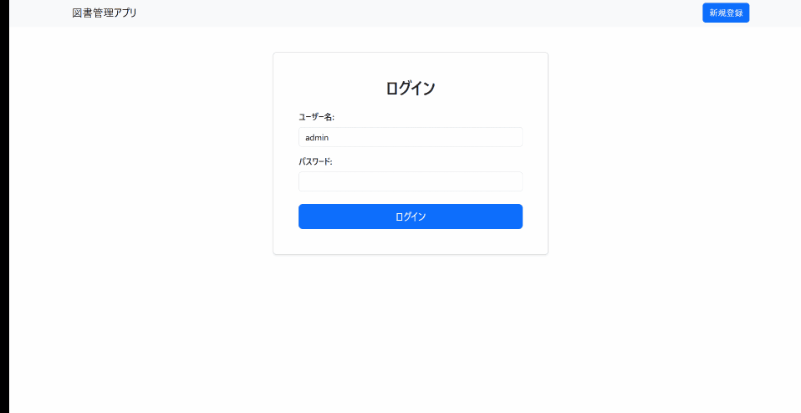
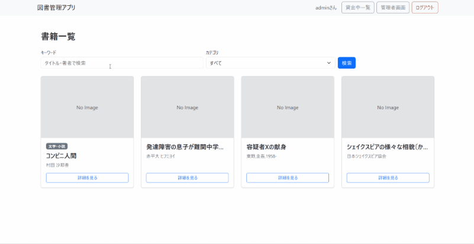
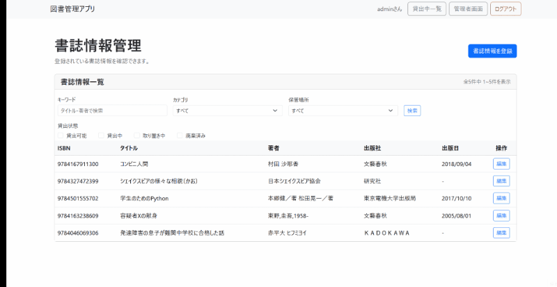
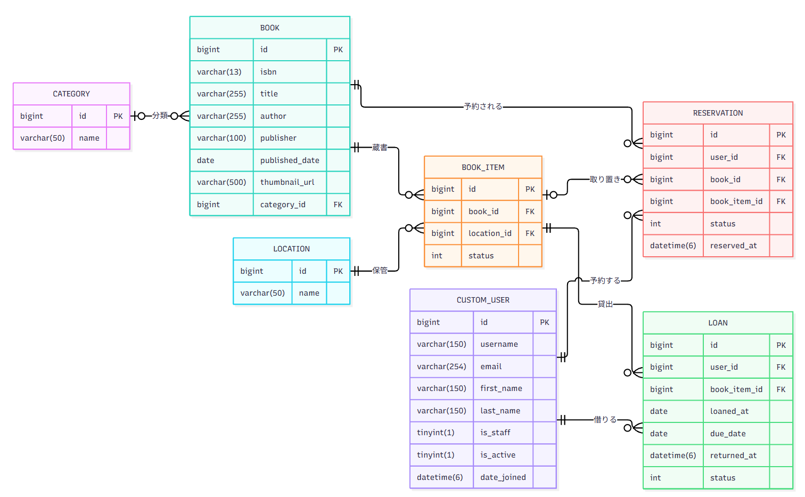

# 分散型図書管理アプリ

## アプリ概要

書籍を一箇所に集約するスペースや管理リソースが確保できない環境でも、各所に分散した書籍を一元管理し、貸出・返却・予約を行えるアプリです。

### 開発背景・課題
※就労移行支援事業所から課題を出して頂き、開発を行った仮想プロジェクトです。

ビル内の複数の場所(本棚)に、数千冊規模の本が分散して保管されています。
図書館として一箇所に集約できれば便利ですが、スペースの不足や管理負担の大きさから実現が難しい状況です。

### 解決策
本は現在の保管場所に置いたまま、**データだけを「仮想の本棚」に集約**します。
物理的に場所がなくても、検索・貸出・返却ができる仕組みを目指して開発しました。

### 機能一覧
アカウントを一般利用者と管理者で分けて、一般利用者にはアプリのメインである書籍の貸出等のみ、
管理者権限を持つアカウントでは書籍の登録、編集、蔵書数の増減等の操作を行えるようにしました。

#### 一般利用者向け機能
| 機能 | 内容 |
|------|------|
| 認証関連 | ログイン、ログアウト |
| 書籍検索・一覧 | 書名・著者名・カテゴリによる検索 |
| 書籍詳細表示 | 書籍情報や貸出状況の確認　|
| 貸出・返却 | 書籍の貸し出し、返却処理 |
| 予約 | 貸出中の本を予約 |
| マイページ | 自身の貸し出し状況・返却期限・予約状況等の確認 |

#### 管理者向け機能
| 機能 | 内容 |
|------|------|
| 管理ダッシュボード | 書籍数・貸出状況・延滞件数などの確認 |
| 書籍登録 | ISBNを利用してAPIから書籍情報の取得・登録 |
| 書籍検索・一覧 | 書名・著者名に加えて保管場所・貸出状況による絞り込み |
| 書籍情報・蔵書数管理 | 登録済みの書籍情報の編集・蔵書数の管理 |

## 使い方

### 書籍の検索・貸出

キーワードやカテゴリから書籍を検索し、詳細画面から貸出手続きを行えます。

### 書籍の登録（管理者機能）

ISBNを使用してOpenBDAPIから書籍情報を自動取得し、保管場所と冊数を指定して登録できます。

## 使用技術
| 分類 | 内容 |
|------|------|
| バックエンド   | Python/Django5.2 |
| フロントエンド | HTML/Bootstrap5/HTMX |
| データベース   | SQLite |
| 外部API | OpenBDAPI |
| コード管理 | Git/GitHub |

## ER図

## 開発時に工夫した点

### 貸出・予約・返却処理の整合性確保

複数のテーブルを更新する処理をサービス層に分離し、Djangoのトランザクション機能を利用しました。処理途中のエラーによってデータに不整合が生じないよう考慮しています。