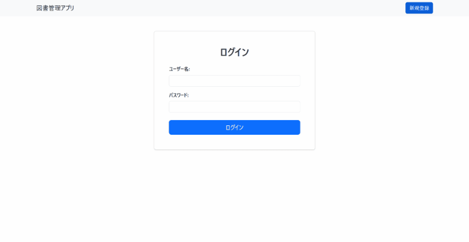
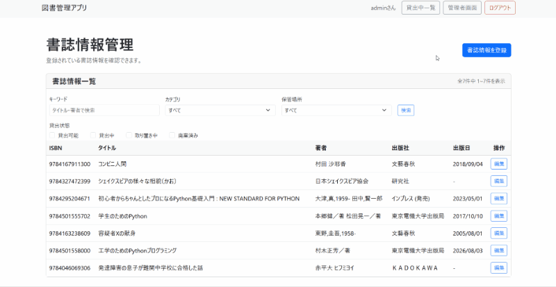

# 分散型図書管理アプリ

## アプリ概要

書籍を一箇所に集約するスペースや管理リソースが確保できない環境でも、各所に分散した書籍を一元管理し、貸出・返却・予約を行えるアプリです。

### 開発背景・課題
※就労移行支援事業所から以下の課題を出して頂き、開発を行った仮想プロジェクトです。

ビル内の複数の場所(本棚)に、数千冊規模の本が分散して保管されています。
図書館として一箇所に集約できれば便利ですが、スペースの不足や管理負担の大きさから実現が難しい状況です。

### 解決策
本は現在の保管場所に置いたまま、データを「仮想の本棚」に集約することによって、
物理的に場所がなくても、検索・貸出・返却ができる仕組みを目指して開発しました。

### 機能一覧
アカウントを一般利用者と管理者で分けて、一般利用者にはアプリのメインである書籍の貸出等のみ、
管理者権限を持つアカウントでは書籍の登録、編集、蔵書数の増減等の操作を行えるようにしました。

#### 一般利用者向け機能
| 機能 | 内容 |
|------|------|
| 認証関連 | ログイン、ログアウト |
| 書籍検索・一覧 | 書名・著者名・カテゴリによる検索 |
| 書籍詳細表示 | 書籍情報や貸出状況の確認　|
| 貸出・返却 | 書籍の貸し出し、返却処理 |
| 予約 | 貸出中の本を予約 |
| マイページ | 自身の貸し出し状況・返却期限・予約状況等の確認 |

#### 管理者向け機能
| 機能 | 内容 |
|------|------|
| 管理ダッシュボード | 書籍数・貸出状況・延滞件数などの確認 |
| 書籍登録 | ISBNを利用してAPIから書籍情報の取得・登録 |
| 書籍検索・一覧 | 書名・著者名に加えて保管場所・貸出状況による絞り込み |
| 書籍情報・蔵書数管理 | 登録済みの書籍情報の編集・蔵書数の管理 |

## 使い方

### 書籍の検索・貸出

キーワードやカテゴリから書籍を検索し、詳細画面から貸出手続きを行えます。

### 書籍の登録（管理者機能）

ISBNを使用してOpenBDAPIから書籍情報を自動取得し、保管場所と冊数を指定して登録できます。

## 使用技術
| 分類 | 内容 |
|------|------|
| バックエンド   | Python3.13.13/Django5.2.16 |
| フロントエンド | HTML/Bootstrap5/HTMX1.9.10 |
| データベース   | SQLite3 |
| 外部API | OpenBDAPI |
| テスト　| DjangoTestCase |
| コード管理 | Git/GitHub |

## ER図

※ CUSTOM_USERは、Django標準のAbstractUserを継承したカスタムユーザーモデル（accounts_customuser）です。ER図では、テーブル間の関係を把握しやすくするため、必要なカラムのみを記載しています。
## 開発時に工夫した点

### 貸出・予約・返却処理の整合性確保
複数の利用者が同時に同一の蔵書を借りようとした際に、データの不整合が発生する可能性を考慮しました。
`transaction.atomic()`を利用し、貸出状況の確認からデータ更新までを一連のトランザクションとして管理しました。処理途中でエラーが発生した場合には変更をロールバックし、一部のデータだけが更新されることを防ぐようにしました。

### 書籍登録作業の効率化
OpenBD APIを利用し、ISBNから書籍情報を自動取得する機能を実装しました。管理者の入力負担を大幅に軽減できるよう工夫しました。

### 主要機能の自動テスト
貸出・返却・予約と、管理者による蔵書管理について、DjangoのTestCaseで自動テスト(39件)を作成しました。

正常系に加え、業務ルール違反の拒否や状態の切り替わりなどを重点的に確認しています。

- 貸出・予約:上限超過や重複貸出・予約等ルール違反の拒否等
- 返却・予約キャンセル：次の予約者への繰り上げ等
- 管理者機能：貸し出し予約中の蔵書を除いた蔵書数の増減・不正な入力での更新拒否等
## 開発中に発生した課題と解決方法

### 貸出・予約状態に応じた画面表示
予約機能の実装時に、予約した書籍が受け取り可能になっても、貸出操作が正しく表示されない問題が発生しました。
原因を調べたところ、画面の条件分岐で予約待ちと受け取り可能の状態を適切に区別できていないことが分かりました。
そこで、予約状態ごとに表示条件を分け、受け取り可能な場合は予約に紐づく蔵書を貸し出せるよう修正しました。

以上です。ここまでご覧いただき誠にありがとうございました。